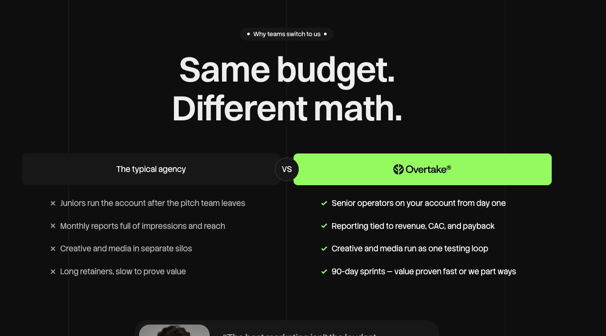
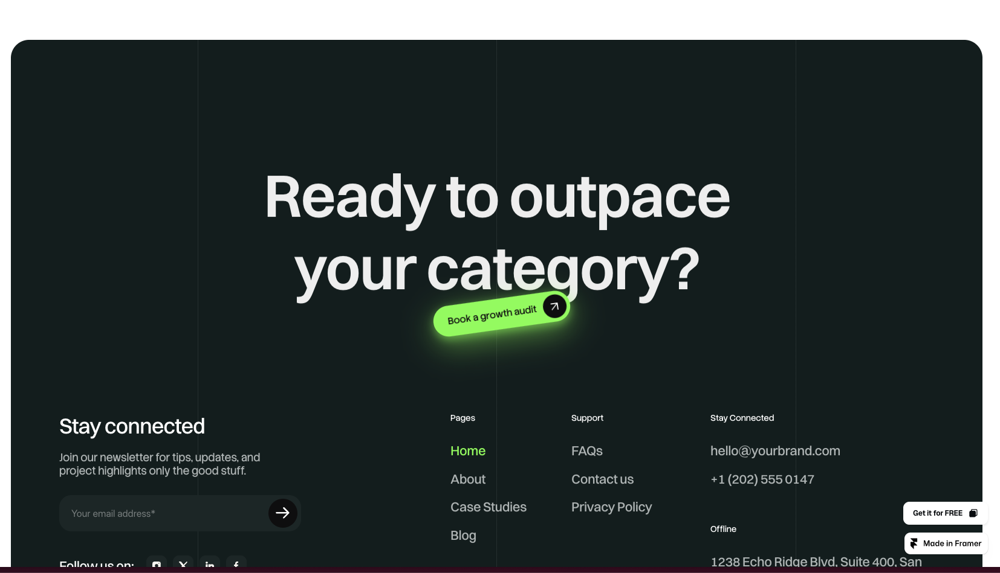
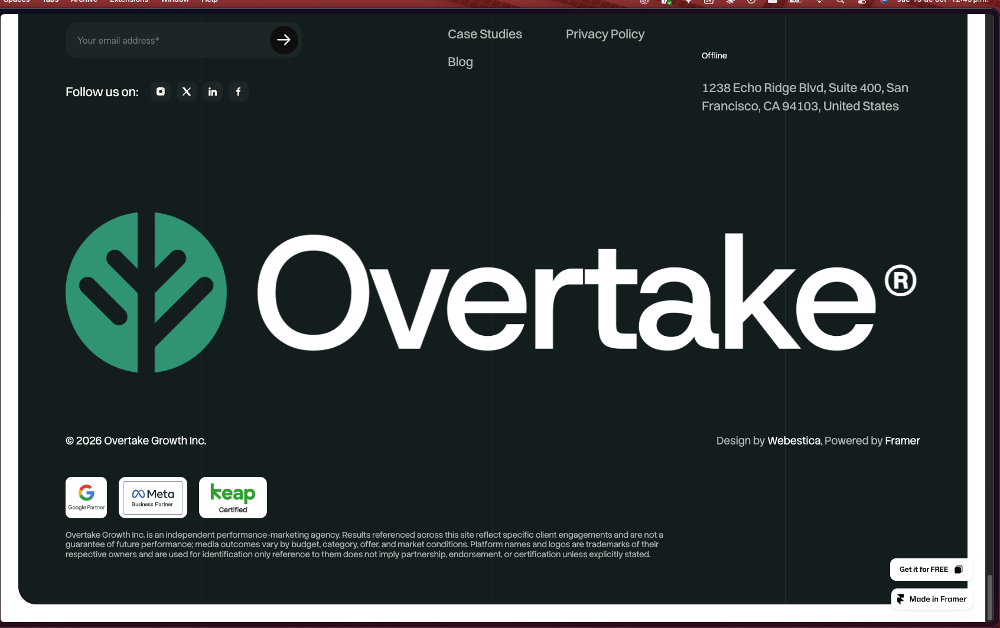
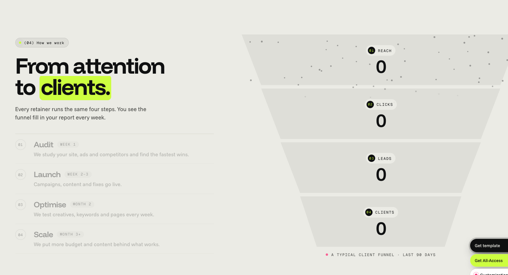

# Referencia de fluidez e interacción: Reachwise

Guardada el 15 de octubre de 2026 por petición de Michelle.

- Sitio: [Reachwise — Digital Marketing Agency](https://joyful-studies-761814.framer.app/)
- Motivo principal: la fluidez general del sitio y la continuidad entre secciones.

## Capturas conservadas

## Qué vale la pena estudiar

- Ritmo de scroll: las secciones se sienten conectadas y cada bloque introduce movimiento con una intención clara.
- Microinteracciones funcionales: contadores, acordeones, pestañas, comparadores y estados que ayudan a explicar el contenido.
- Visualización del proceso: el embudo convierte una secuencia abstracta en una experiencia que se entiende mientras avanza.
- Transiciones entre fondos claros y oscuros sin perder continuidad visual.
- CTAs con movimiento y presencia, pero subordinados al mensaje principal.
- Footer amplio y expresivo, con la marca usada como cierre visual.

## Criterio de adaptación

Tomar la sensación de fluidez, el ritmo y el uso explicativo del movimiento; no copiar la identidad, el verde neón, la tipografía, los textos, la estructura exacta ni los recursos de marca. Cualquier implementación debe usar los tokens del proyecto, respetar `prefers-reduced-motion` y conservar la claridad en móvil.

