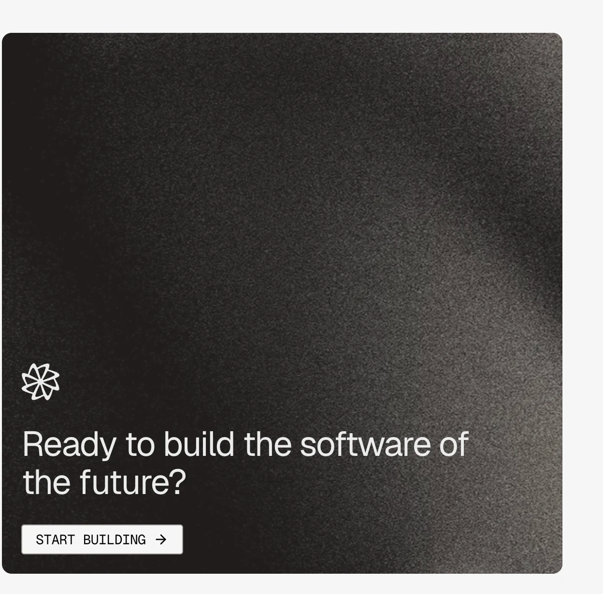

# Referencia: fondo oscuro con grano y luz suave

Guardada el 21 de octubre de 2026 por petición de Michelle, como referencia de **background**.

## Qué tiene el fondo

- **Base casi negra y cálida.** Va de un negro con tinte café a la izquierda a un gris topo más claro arriba a la derecha. No es negro puro.
- **Luz difusa en diagonal.** Una mancha de luz suave entra desde la esquina superior derecha y se apaga hacia abajo a la izquierda. Parece tela o una superficie mate iluminada de lado, no un degradado lineal.
- **Grano fino y denso en toda la superficie.** Se nota más en las zonas claras. Le da textura de impresión o de foto analógica.
- **Contenido abajo a la izquierda:** un ícono de línea blanco, un titular grande en blanco hueso y un botón claro rectangular con tipografía monoespaciada en mayúsculas.
- **Esquinas con radio pequeño** y mucho espacio vacío arriba: el fondo es el protagonista.

## Cómo encaja con el sitio

- El grano ya existe en el sitio (`--grain`, la clase `.grain`). Este fondo lo usa más denso y sobre una base oscura con luz.
- Para recrearlo se pueden apilar dos o tres `radial-gradient` desenfocados (luz arriba a la derecha y sombra abajo a la izquierda) sobre `--bg` oscuro, y encima la capa `.grain` con más opacidad que la actual.
- Candidatos para usarlo: el footer (`.theme-inverse`), el CTA de cierre o una tarjeta destacada.
