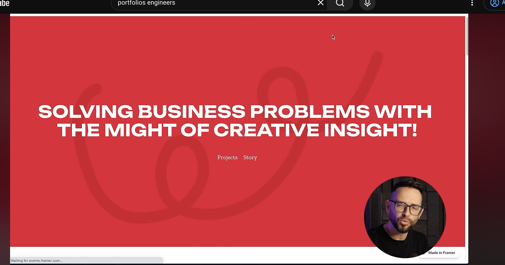

# Referencia para footer o CTA

Guardada el 10 de octubre de 2026 por petición de Michelle.

Detalle seleccionado: el listón ancho y curvo de fondo, con bucles amplios y contraste tonal bajo, detrás de un mensaje principal. Explorar su uso en el footer o CTA usando los colores del proyecto. El interés está en el listón; no implica copiar el color rojo, el texto, la tipografía o el resto de la página. Pendiente de proponer cuando revisemos esa sección.
