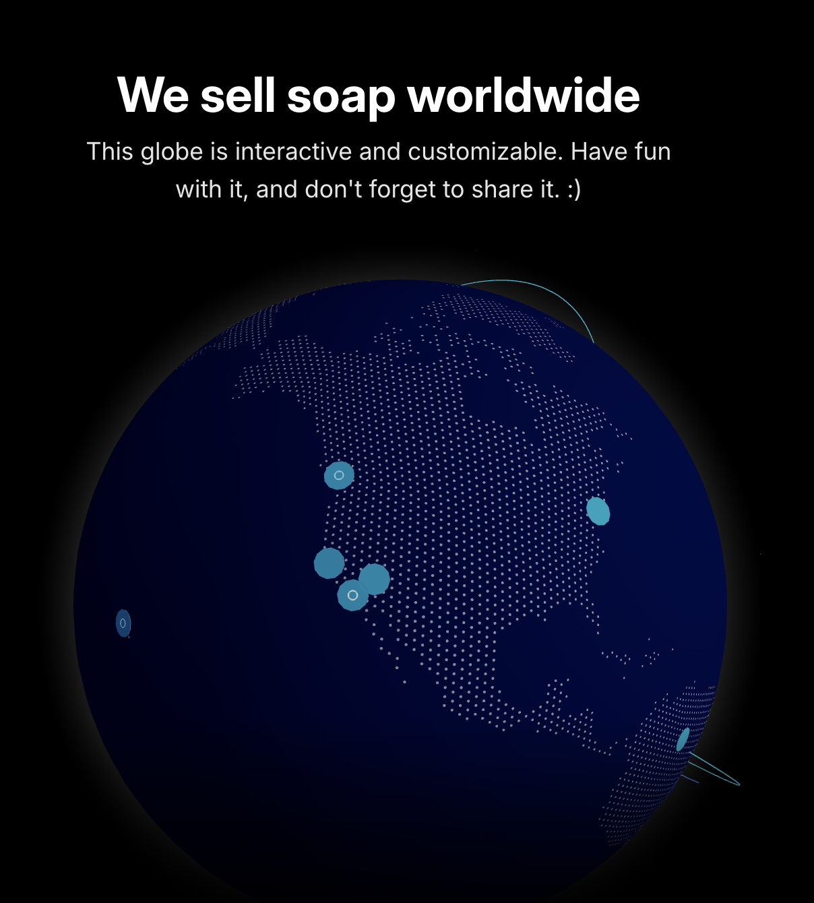

# Globo interactivo con conexiones

Referencia guardada el 11 de octubre de 2026.

Para explorar en otra sección del sitio: globo con continentes dibujados por partículas, profundidad esférica, marcadores y arcos de conexión. La captura sugiere interacción y personalización, pero no documenta el comportamiento; definirlo cuando se trabaje esa sección. Adaptar la estética a los colores del portfolio y conservar el protagonismo de los puntos. No trasladar el texto ni la identidad de la referencia.
