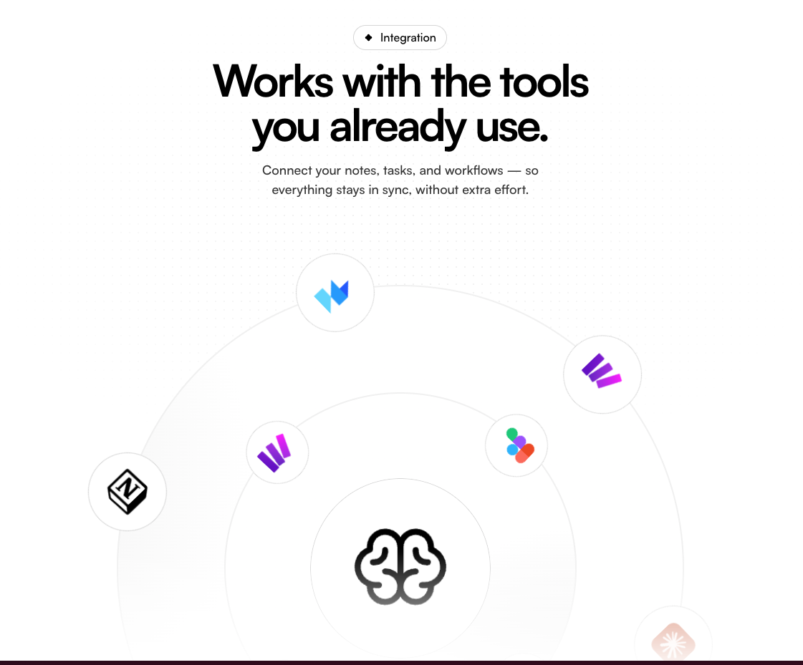

# Referencia gráfica: integraciones en órbitas

Guardada el 15 de octubre de 2026 a partir de una captura aportada por Michelle.

## Recurso visual a conservar

Un núcleo central representa el producto o la inteligencia principal; las herramientas aparecen como nodos distribuidos en órbitas concéntricas. La composición comunica compatibilidad y ecosistema sin recurrir a una lista o cuadrícula convencional.

Explorarla para una sección de integraciones usando iconos autorizados, colores del proyecto, trazos finos y movimiento sutil. No copiar marcas ni la composición exacta. Debe seguir siendo comprensible sin animación y responder a movimiento reducido.
