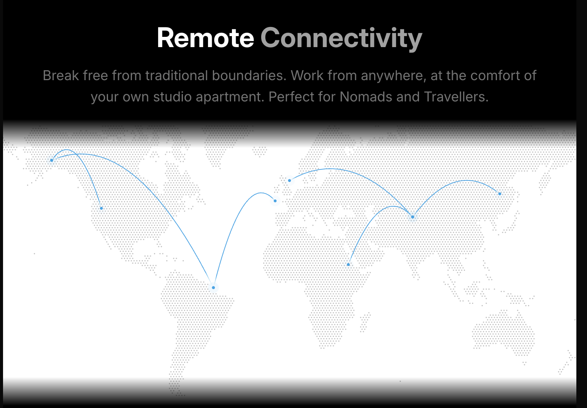

# Mapa de conexiones con partículas

Referencia guardada el 11 de octubre de 2026.

Explorar en otra sección del sitio un mapa mundial de puntos con trayectorias curvas y señales que conectan lugares. Conservar la ligereza de las partículas y adaptar los colores al sistema del portfolio. La ubicación queda pendiente.
