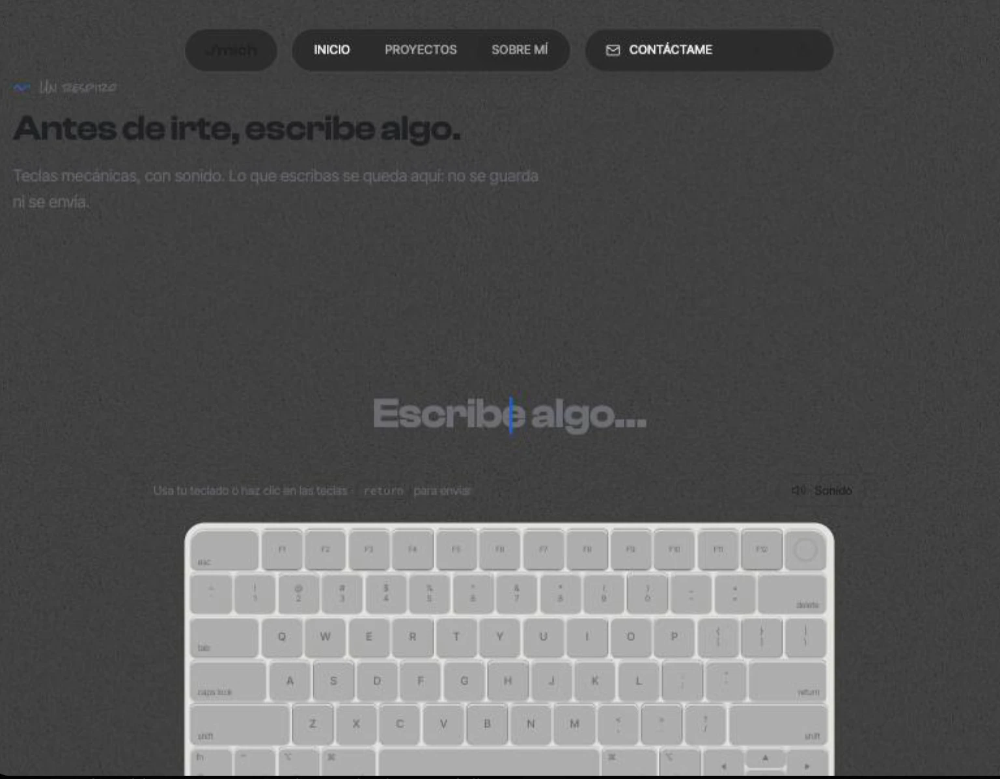

# Referencia: teclado y sección en gris

Guardada el 21 de octubre de 2026 por petición de Michelle.

## Qué le gustó

- Todo en una sola gama de grises: fondo gris medio con grano, texto y teclado apagados, sin blanco puro ni negro puro.
- El teclado claro resalta poco sobre el gris; se siente tranquilo, casi como una foto desaturada.
- El cursor azul es el único color de la pantalla y por eso se lee de inmediato.

## Contexto

La captura salió de un estado de carga (la página aún sin hidratar, con una capa gris encima), no de un diseño hecho a propósito. Si se quiere usar, hay que recrearlo como tema o variante: fondo intermedio entre `--bg` claro y oscuro, tinta con poco contraste y el acento como único color.
