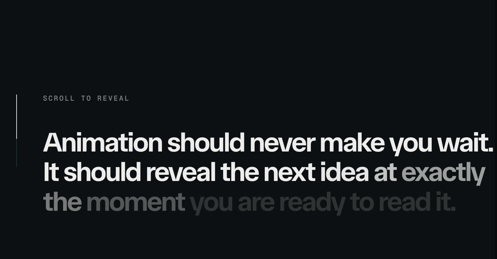

# Texto que se ilumina con el scroll

Referencia guardada el 11 de octubre de 2026.

Fuente: [Motion · Scroll word reveal](https://motion.dev/examples/react-text-scroll-word-reveal).

El texto empieza atenuado y cada palabra gana luminosidad con el avance del scroll. El efecto es reversible y continuo, sin destellos de partículas ni desplazamientos del texto. Aplicar al contenido de cada etapa del preview de Mi enfoque, conectado al mismo progreso del gráfico. Con movimiento reducido o animaciones pausadas, mostrar todo el texto con luminosidad normal.
